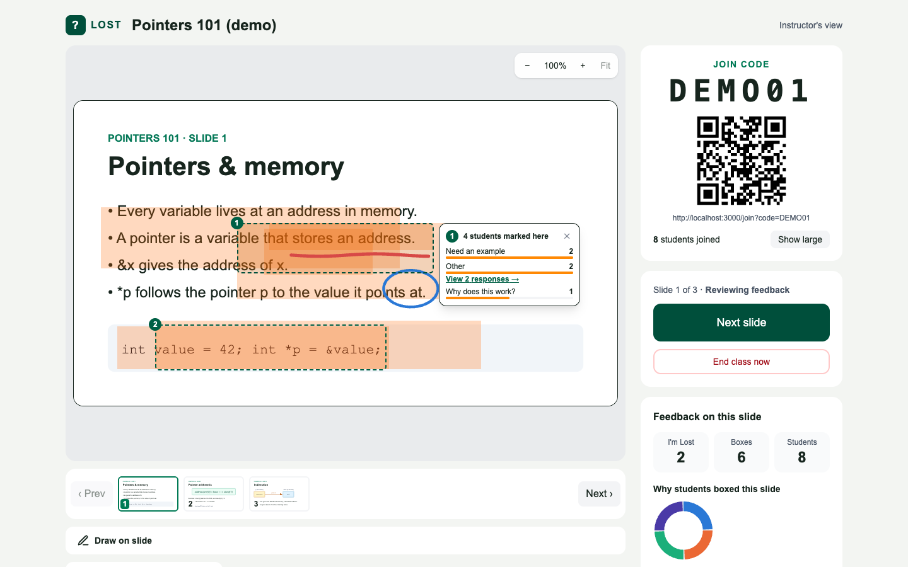
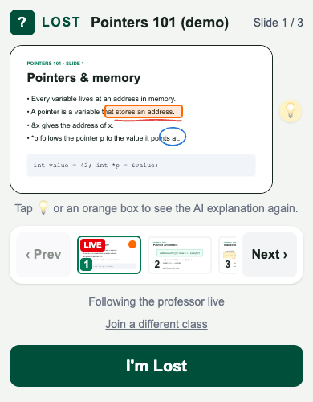
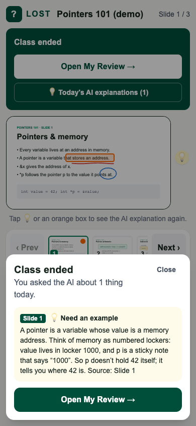
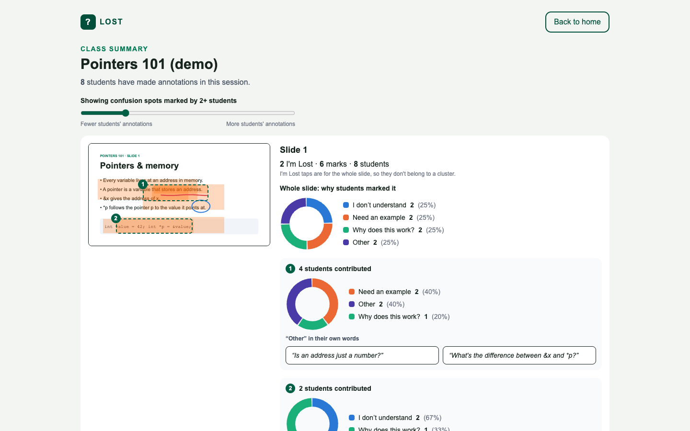
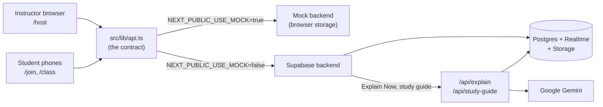

# LOST

**Make confusion visible.** Students mark exactly where a lecture slide loses them, quietly and in real time. Before moving on, the instructor sees a heatmap of where the class is confused and why. Each student gets AI explanations of what they marked and a personal study guide after class.

**Live app:** <https://i-m-lost.vercel.app>

<p align="center">
  
</p>

## The problem

In a lecture, the students who are lost are the least likely to raise a hand, and the instructor often finds out at the exam. A show of hands or an end-of-class poll says *whether* the class is confused, not *where* on the slide or *why*.

## How it works

1. **The instructor uploads a PDF** in the browser and gets a 6-character join code and a QR code.
2. **Students scan the QR code** on their phones. Their screen follows the instructor's slide live.
3. **A student who is lost** taps **I'm Lost** for the whole slide, or **highlights the exact line** and (optionally) says why: *I don't understand*, *Need an example*, *Why does this work?*, or *Other* with their own question. The mark is saved for later, or the student taps **Explain Now** for an AI explanation of that exact spot.
4. **Before moving on, the instructor clicks Review.** A heatmap shows where highlights overlap. Spots marked by several students get a number. Hovering a spot shows why students marked it; clicking keeps it open and shows the students' own questions.
5. **The instructor can explain on the spot** by drawing on the slide (mouse, finger or Apple Pencil). The ink appears on every student's phone.
6. **When class ends**, the instructor gets a summary of every slide. Each student gets a recap of their AI explanations and a private **My Review** page with a personal study guide.

<p align="center">
  
  &nbsp;
  
</p>

## Features

### Instructor

- **PDF to class in one step.** The PDF is converted to slide images in the browser (pdf.js, up to 20 pages, works on Safari and iPad), and each slide's text is kept for the AI.
- **Join code and QR code**, with a full-screen QR view and a live count of students who joined.
- **Presenting, Reviewing, Next.** One button pauses on the slide to review feedback, the next one moves on. The instructor can also jump to any slide or end the class at any time.
- **Heatmap with a clean-view toggle**, so the slide can be projected without the overlay.
- **Confusion spots.** Overlapping highlights are grouped into numbered spots once enough students mark the same place. Each spot has a reasons breakdown on hover; clicking pins it and shows the "Other" responses in the students' own words.
- **Whole-slide feedback panel** with I'm Lost taps, marks, students, and a donut chart of reasons.
- **Draw on slides**, synced to every student live. Three pen colours, two widths, Undo (Ctrl/Cmd+Z) and Clear. On iPad the Apple Pencil draws while fingers move and zoom the slide, like GoodNotes; on phones one finger draws and two fingers move and zoom.
- **Zoom and pan** any slide, sized to fit the screen.
- **End-of-class summary**: for every slide, a heatmap snapshot with numbered spots and the instructor's ink, a reasons donut for the whole slide and for each spot, and every "Other" response. A slider sets how many students it takes to make a spot.
- **No login needed to come back**: classes started on a device are listed on the start page.

### Student

- **Join by QR code or code**, no account. The device remembers the class.
- **Follows the live slide**, with a thumbnail strip to look back at any slide and a **LIVE** tag to return.
- **I'm Lost**: one tap marks the whole slide.
- **Highlighter** to mark the exact part: adjustable brush, Undo, strokes along a line of text straighten into neat bars, one box per highlighted part, and a corner handle to resize a part. Quick taps don't paint, so stray touches don't leave marks. With an Apple Pencil, the pencil highlights while fingers scroll and zoom.
- **Optional reasons** (pick several), including *Other* with a short typed question.
- **Save for Later** (the default) or **Explain Now**. Explanations stay one tap away in a 💡 rail beside the slide, or by tapping your own highlight.
- **Sees the instructor's ink** on the live slide.
- **After class**: a recap of the day's AI explanations and **My Review**, visible only to that student, with their marks slide by slide and a study guide built from them.

### AI (Google Gemini, server-side only)

- **Explain Now** sends the slide image, the slide's text, a close-up of the marked area, the slide with that area outlined, the chosen reasons and the student's question. The answer is under 150 words, in plain text with textbook-style math, and ends with "Source: Slide N".
- **Study guide**: one section per slide the student marked, with the concept, an explanation, a practice question and the source slide.
- **Built to fail safely**: the mark is saved before the AI is called, so a failed explanation can be retried and nothing is lost. Each request has a time limit, one quick retry and a fallback model.
- **Student text is treated as data, not instructions**, so a typed question can't redirect the AI.

### Privacy

Students are anonymous to the instructor. The instructor sees counts, heatmaps and the text of "Other" responses, never who wrote what. Students never see each other's marks, and each student's AI explanations and study guide are visible only to them.

<p align="center">
  
</p>

## Tech stack

| Area | Tools |
| --- | --- |
| App | [Next.js 16](https://nextjs.org) (App Router), React 19, TypeScript, Tailwind CSS 4 |
| Data and live sync | [Supabase](https://supabase.com): Postgres, Realtime (database changes pushed to every screen), Storage (slide images) |
| PDF | [pdf.js](https://mozilla.github.io/pdf.js/) (`pdfjs-dist` legacy build), in the browser |
| AI | Google Gemini (`gemini-3.8-flash`, falling back to `gemini-3.5-flash-lite`), called from Next.js API routes; `sharp` crops the marked areas |
| Other | `qrcode.react`, Vercel hosting, GitHub Actions CI, Node's built-in test runner |

## Architecture



Every screen gets data through one file, [`src/lib/api.ts`](src/lib/api.ts). It switches between a mock backend that runs entirely in the browser (for building without accounts) and the real Supabase backend. Details are in [docs/architecture.md](docs/architecture.md).

## Run it locally

You need Node.js 22 or newer.

```sh
npm ci
cp .env.example .env.local
npm run dev
```

Open <http://localhost:3000>. By default the app runs on the **mock backend**: no accounts or keys are needed, and the data lives in your browser.

To try the demo class in one browser:

- Instructor: <http://localhost:3000/host/00000000-0000-4000-8000-000000000001>
- Student: <http://localhost:3000/join?code=DEMO01> (each tab is a different student)

To reset the mock data, run `localStorage.removeItem("lost-mock-db-v1")` in the browser console and refresh. In mock mode the AI answers are placeholders.

### Use the real backend

1. Create a [Supabase](https://supabase.com) project. In the SQL Editor, run the files in [`supabase/migrations/`](supabase/migrations) in order (0001, 0002, 0003).
2. Get a Gemini API key from [Google AI Studio](https://aistudio.google.com/apikey).
3. Fill in `.env.local`:

| Variable | What it is |
| --- | --- |
| `NEXT_PUBLIC_USE_MOCK` | `false` to use Supabase; `true` (default) for the in-browser mock |
| `NEXT_PUBLIC_SUPABASE_URL` | Supabase project URL (Project Settings, API) |
| `NEXT_PUBLIC_SUPABASE_ANON_KEY` | Supabase anon (public) key |
| `GEMINI_API_KEY` | Server-only Gemini key. Never prefix it with `NEXT_PUBLIC_` |
| `GEMINI_MODEL` | Optional; overrides `gemini-3.8-flash` |

### Scripts

| Command | What it does |
| --- | --- |
| `npm run dev` | Start the dev server on port 3000 |
| `npm run typecheck` | Type-check the whole project |
| `npm test` | Run the unit tests in `tests/` |
| `npm run build` | Production build (CI runs typecheck, tests and build on every push) |

## Project structure

```text
src/
  app/                    pages (Next.js App Router)
    page.tsx              start page
    host/                 instructor: upload, live screen, end-of-class summary
    join/, class/         student: join, live screen, My Review
    api/                  server routes that call Gemini
  features/
    professor/            instructor screen components (heatmap, spots, charts, pen)
    student/              student screen components (highlighter, reasons, AI panels)
    annotations/          instructor ink, shown on both sides
  components/SlideView.tsx  slide display shared by every screen
  lib/
    api.ts                the contract every screen uses
    types.ts, domain.ts   shared data shapes and logic
    backend/              mock and Supabase backends, shared validation rules
supabase/migrations/      database schema
public/                   demo slides and the pdf.js worker
tests/                    unit tests
docs/                     product decisions, PRD, architecture, testing, build plan
```

## Docs

- [Product decisions](docs/decisions.md): what we decided and why
- [PRD](docs/PRD.md): the product requirements and what was built
- [Architecture](docs/architecture.md): data model, live sync, AI pipeline
- [Testing](docs/testing.md): automated tests and a manual test script
- [Contributing](CONTRIBUTING.md): setup, branches and pull requests
- [Build plan](docs/build-plan.md): the original 10-hour plan, kept as a record

## Limitations

This is a hackathon build. Security is demo-level: there is no instructor login, row-level security is off, and anyone with the public Supabase key can read and write the class tables. Do not use it with real student data as is. Audio transcription, LMS integration and exporting data are not built.

## Team

Built in 10 hours by a team of three, split by screen so the pieces could be built in parallel:

- **Person A**: instructor screens
- **Person B**: student screens
- **Person C**: database, live sync, AI routes, hosting, and merging

We built it with AI coding assistants. [AGENTS.md](AGENTS.md) holds the rules they followed.
