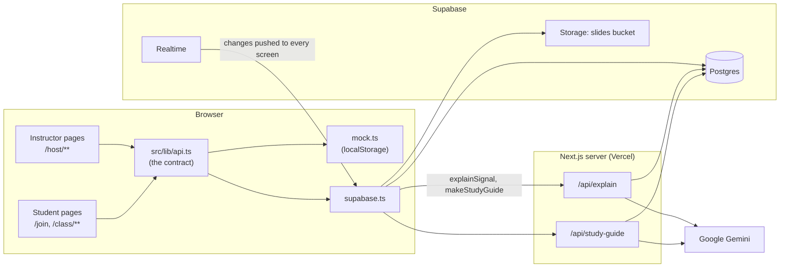

# Architecture

How LOST is put together. For what it does, see the [README](../README.md). For why, see [decisions.md](decisions.md).

## Overview

LOST is a single Next.js app. Instructor and student screens are pages in the same app. They share one data layer, and two server routes call the AI.

## The contract: `src/lib/api.ts`

Pages and components never talk to the database. They call the functions in [`src/lib/api.ts`](../src/lib/api.ts), and the `Backend` type there makes `npm run typecheck` fail if a backend drifts from it. This let the instructor screens, the student screens and the backend be built in parallel by three people.

| Group | Functions |
| --- | --- |
| Instructor | `createSession`, `getSession`, `updateLive`, `subscribeToSession`, `getSlideSignals`, `subscribeToSignals`, `countStudents` |
| Student | `joinSession`, `getMyStudentId`, `submitSignal`, `getMySignals`, `explainSignal`, `makeStudyGuide` |
| Instructor ink | `addAnnotation`, `getAnnotations`, `removeAnnotations`, `subscribeToAnnotations` |

`NEXT_PUBLIC_USE_MOCK` picks the backend:

- **Mock** ([`src/lib/backend/mock.ts`](../src/lib/backend/mock.ts), the default): all data lives in the browser's `localStorage`. Tabs of the same browser update each other through the `storage` event, and each tab is a different student. It seeds a demo class (code `DEMO01`), shrinks uploaded slides to fit browser storage, and returns placeholder AI answers. Setting `localStorage["lost-mock-fail-ai"] = "1"` makes AI calls fail, for testing error states.
- **Real** ([`src/lib/backend/supabase.ts`](../src/lib/backend/supabase.ts)): Supabase Postgres, Realtime and Storage, plus the AI routes.

Both backends share the validation rules and exact error messages in [`src/lib/backend/rules.ts`](../src/lib/backend/rules.ts).

## Data model

Shapes are in [`src/lib/types.ts`](../src/lib/types.ts); the schema is in [`supabase/migrations/`](../supabase/migrations).

| Table | Holds | Notes |
| --- | --- | --- |
| `sessions` | One class: join code, title, slide count, `current_slide`, `phase` (`presenting`, `reviewing`, `ended`) | Realtime on |
| `slides` | Per slide: image URL (in the public `slides` bucket) and the text extracted from the PDF | |
| `members` | Who joined: anonymous student id and optional name | Used for the joined count |
| `signals` | Student feedback: `kind` (`lost` or `region`), the box (`x`, `y`, `width`, `height` as 0..1 fractions of the slide), reasons, `other_text`, the AI `explanation` | Realtime on. At most one `lost` per student per slide (unique index). |
| `annotations` | Instructor pen strokes: points (0..1 fractions), colour, width (fraction of slide width), `removed_at` | Realtime on. Undo and Clear set `removed_at` instead of deleting. |

Migrations, run in order in the Supabase SQL Editor:

1. `0001_hackathon.sql`: sessions, slides, members, signals, the storage bucket
2. `0002_other_text.sql`: students' own words for *Other* (1 to 200 characters)
3. `0003_annotations.sql`: instructor pen strokes

**Ids are made in the browser** (`crypto.randomUUID()`) and saved with upsert, so retrying a save after a network error can never create a duplicate.

**Positions are fractions of the slide** (0 to 1), never pixels. [`src/components/SlideView.tsx`](../src/components/SlideView.tsx) draws a slide and anything placed on it (`RectBox`), and converts a pointer position to slide fractions (`toSlideFraction`). That is why marks and ink land on the same words on a phone, a laptop and a projector, at any zoom.

## Live sync

- The instructor's screen writes `current_slide` and `phase` (`updateLive`). Every student's screen subscribes to the session row through Supabase Realtime and follows it, unless the student has browsed to another slide.
- The instructor's screen subscribes to new `signals` and redraws the heatmap and charts as marks arrive.
- Instructor ink flows the other way: strokes are saved when the pen lifts, and every student's screen subscribes to `annotations` (added and removed events).
- Realtime can miss events while a phone sleeps or the network drops. Each subscription re-reads the current state when it reconnects or when the page becomes visible again.
- Identity: each device gets an anonymous student id in `localStorage` (one phone, one student). The mock keeps it in `sessionStorage` instead, so each tab is a different student.

## Slides from a PDF

[`src/features/professor/pdfToSlides.ts`](../src/features/professor/pdfToSlides.ts) converts the PDF in the instructor's browser: each page becomes a PNG (at most 2000 px wide) plus its extracted text, up to 20 pages. `createSession` uploads the images to Storage and creates the class.

It uses pdf.js's **legacy** build, with a small stream fix (`public/pdfjs/`), because the normal build relies on JavaScript features that Safari, iPhone and iPad don't support yet.

## Confusion spots

[`src/features/professor/denseAreas.ts`](../src/features/professor/denseAreas.ts) lays an 80 × 60 grid over the slide and counts how many **different students** marked each cell. Cells marked by at least the threshold number of students (2 by default) are grouped with their touching neighbours into areas. Each area gets a bounding box, its student count, a reason breakdown (each student counted once per reason) and the "Other" responses inside it. The live screen and the end-of-class summary both use it.

## AI pipeline

Two server routes call Google Gemini through its Interactions REST API with `fetch` (no SDK). `GEMINI_API_KEY` is read only on the server.

- **`POST /api/explain` `{ signalId }`**: loads the signal and its slide, downloads the slide image, and uses `sharp` (bundled with Next.js) to make a close-up of the marked area and a copy of the slide with that area outlined in red. It sends both, the slide's text, the reasons and the student's own words to Gemini, then saves the explanation on the signal.
- **`POST /api/study-guide` `{ sessionId, studentId }`**: does the same for every slide that student marked and asks for one section per slide: concept, explanation, practice question, source.

Prompts are in [`src/app/api/ai.ts`](../src/app/api/ai.ts). They ask for plain text with Unicode math (the student screens don't render Markdown), require a "Source: Slide N" line, and wrap the student's words in `<student_note>`, which the model is told to answer but never follow as instructions.

Reliability:

- Each Gemini request has a time limit (explain: 15 s per try, 45 s total; study guide: 40 s per try, 90 s total), below the routes' Vercel limits of 60 s and 120 s.
- A busy model gets one retry 0.8 s later, then the app falls back from `gemini-3.8-flash` to `gemini-3.5-flash-lite`.
- The signal is saved **before** the AI is called, so a failed explanation never loses the student's mark, and they can try again.

## Security

Demo-level, on purpose, for a 10-hour build: no logins, row-level security off, and the public anon key can read and write the class tables and upload to the `slides` bucket. The only secret, the Gemini key, stays on the server. A real deployment would need instructor accounts, anonymous auth for students, row-level security policies, and server-side checks that a student belongs to the class.

## Code layout

| Path | Owner during the build | What's there |
| --- | --- | --- |
| `src/app/page.tsx`, `src/app/host/**`, `src/features/professor/**` | Person A | Start page, upload, instructor live screen, summary |
| `src/app/join/**`, `src/app/class/**`, `src/features/student/**` | Person B | Join, student live screen, My Review |
| `src/lib/**`, `src/app/api/**`, `supabase/**` | Person C | Contract, backends, AI routes, schema |
| `src/components/SlideView.tsx`, `src/features/annotations/**` | Shared | Slide display and instructor ink, used by both sides |
